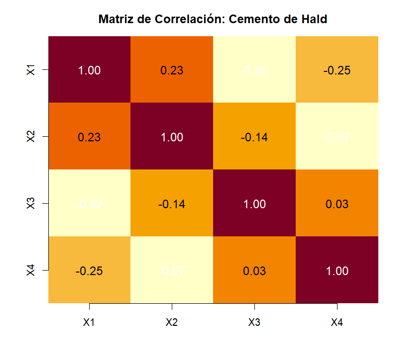
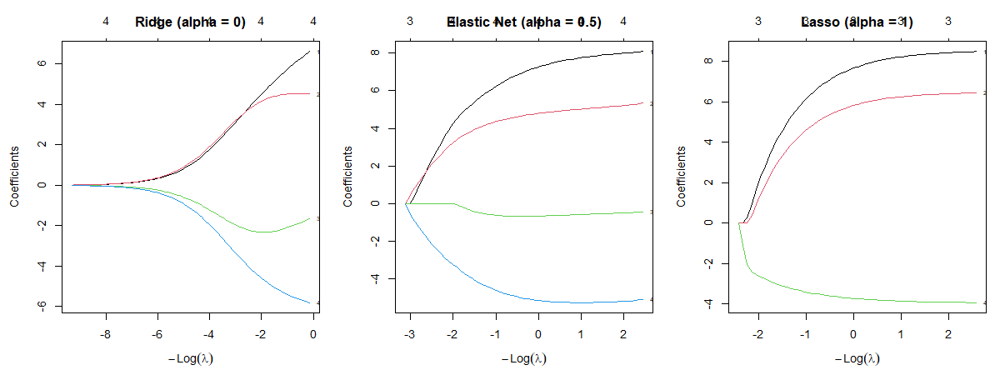
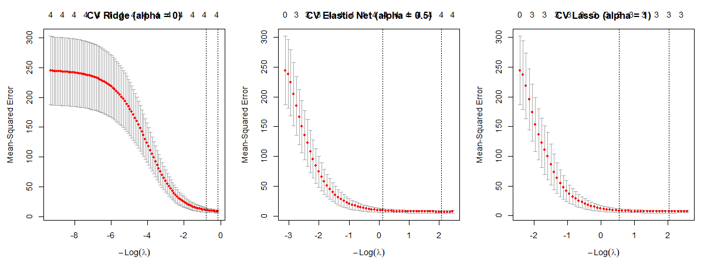
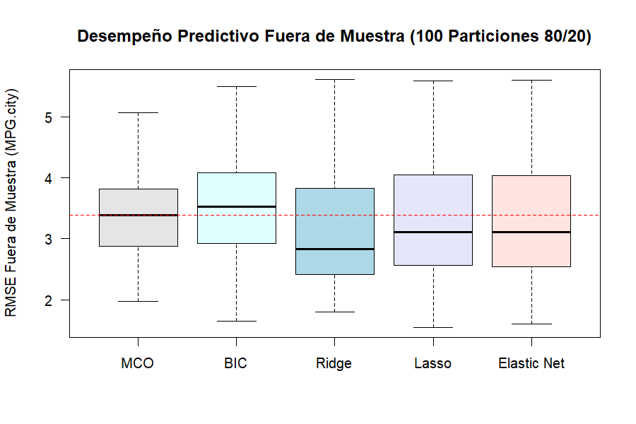
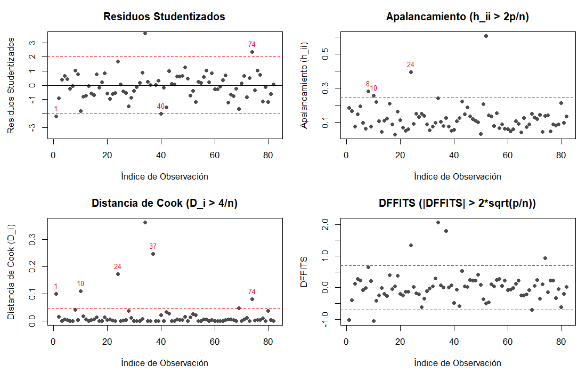

```{r setup, include=FALSE}
# Carga de resultados generados por el ejecutor
leer_out <- function(nombre) {
  f <- file.path("..", "out", paste0(nombre, ".txt"))
  if (file.exists(f)) readLines(f, warn = FALSE) else "(pendiente de ejecución)"
}

leer_tabla <- function(nombre) {
  f <- file.path("..", "out", "tablas", paste0(nombre, ".csv"))
  if (file.exists(f)) read.csv(f, row.names = 1, check.names = FALSE) else NULL
}
```

\newpage

# Pregunta de investigación y datos

## Objetivo del estudio

El objetivo central de este laboratorio consiste en comparar el impacto de la multicolinealidad sobre la inferencia y la capacidad predictiva en regresión lineal múltiple, contrastando la selección clásica de variables frente a métodos modernos de regularización [@ravishanker2026statistical; @belsley1980regression; @zou2005regularization].

En términos de modelación, se distingue rigurosamente el propósito analítico:
1. **Objetivo explicativo (Hald):** Identificar la contribución individual y la plausibilidad fisicoquímica de los componentes del cemento sobre el calor de hidratación, donde la colinealidad infla los errores estándar y desestabiliza los signos de MCO.
2. **Objetivo predictivo y parsimonioso (Cars93 y BostonHousing):** Predecir la eficiencia de combustible (`MPG.city`) y el valor de las viviendas (`medv`) optimizando el compromiso sesgo–varianza fuera de muestra y previniendo la fuga de información.

## Descripción de los datos

```{r}
#| label: tbl-resumen-datos
#| tbl-cap: "Resumen estructural de los conjuntos de datos analizados."
tb_datos <- leer_tabla("resumen_datasets")
if (!is.null(tb_datos)) knitr::kable(tb_datos, digits = 2)
```

La @tbl-resumen-datos sintetiza las dimensiones, conteo de valores faltantes y variables de respuesta de los datos analizados:

- **Hald (`mctest`):** Conjunto clásico de $n = 13$ observaciones de cemento Portland con $p = 4$ predictores químicos continuos: $X_1$ (aluminato tricálcico), $X_2$ (silicato tricálcico), $X_3$ (ferrito aluminato tetracálcico) y $X_4$ (silicato dicálcico). La variable respuesta $y$ es el calor desprendido tras 180 días (calorías/gramo). No presenta valores faltantes [@ravishanker2026statistical].
- **Cars93 (`MASS`):** Registra especificaciones automotrices del año 1993. Tras la decisión metodológica de F1, se analiza un subconjunto estricto de casos completos con **$n = 82$ observaciones** y **16 predictores continuos**, excluyendo las 11 filas con valores faltantes en `Rear.seat.room` y `Luggage.room` para asegurar comparabilidad en $AIC$ y $BIC$. La variable respuesta es `MPG.city` (millas por galón en ciudad). Se excluyó del conjunto principal `MPG.highway` por constituir una redundancia mecánica determinista `[Heurística]`.
- **BostonHousing (`mlbench`):** $n = 506$ observaciones del censo de Boston sobre 4 predictores seleccionados: proporción industrial (`indus`), número medio de habitaciones (`rm`), ratio alumno-profesor (`ptratio`) y porcentaje de población de bajo estatus socioeconómico (`lstat`). Variable respuesta: valor mediano de viviendas en miles de dólares (`medv`).

---

# Diagnóstico de multicolinealidad {#sec-diagnostico}

*Fase F2. Líder: Sebastián Osses (Est. B).*

## Matriz de correlaciones

En la presencia de multicolinealidad severa, los predictores comparten información redundante que deteriora el condicionamiento de la matriz de diseño $X^TX$ [@belsley1980regression].

{#fig-hald-cor width=75%}

Como se ilustra en la @fig-hald-cor, en los datos de Hald existen correlaciones bivariadas fuertemente negativas entre $X_2$ y $X_4$ ($r = -0.9730$) y entre $X_1$ y $X_3$ ($r = -0.8241$) `[Evidencia numérica]`. En Cars93, los predictores de precio exhiben una colinealidad extrema: `Min.Price` y `Price` presentan una correlación de $r = 0.9826$, y `Price` con `Max.Price` de $r = 0.9817$ `[Evidencia numérica]`.

## Factores de Inflación de la Varianza (VIF)

El Factor de Inflación de la Varianza del $j$-ésimo predictor se define teóricamente como $VIF_j = \frac{1}{1 - R_j^2} = [\text{diag}(R_{XX}^{-1})]_j$, cuantificando la inflación del error estándar respecto a un diseño ortogonal `[Demostrado]`.

```{r}
#| label: tbl-hald-vif
#| tbl-cap: "Verificación numérica de VIF por definición vs car::vif en Hald."
tb_hvif <- leer_tabla("hald_vif_comparacion")
if (!is.null(tb_hvif)) knitr::kable(tb_hvif)
```

La @tbl-hald-vif confirma que el cálculo analítico por inversión de la matriz de correlación coincide de forma exacta con la implementación de `car::vif()`, con una discrepancia numérica inferior a $10^{-14}$ `[Demostrado]`. En Hald, los 4 predictores superan holgadamente la regla heurística habitual de $VIF > 10$, alcanzando $254.42$ en $X_2$ y $282.51$ en $X_4$ `[Evidencia numérica]`. En Cars93, 8 de los 16 predictores tienen $VIF > 10$, destacando `Price` con un $VIF = 166,975.66$ y `Min.Price` con $VIF = 33,391.68$ `[Evidencia numérica]`.

## Autovalores, índices de condición y descomposición BKW

El número de condición de una matriz se define como $\kappa = \sqrt{\lambda_{\max} / \lambda_{\min}} = \eta_{\max}$. Belsley, Kuh y Welsch (1980) demostraron que centrar los predictores puede enmascarar colinealidades que involucran al intercepto; por ende, su método estandariza las columnas a longitud euclidiana unitaria sin centrar [@belsley1980regression].

```{r}
#| label: tbl-diag-comp
#| tbl-cap: "Comparación de índices y número de condición entre Hald y Cars93."
tb_dcomp <- leer_tabla("diagnostico_colinealidad_comparativo")
if (!is.null(tb_dcomp)) knitr::kable(tb_dcomp, digits = 2)
```

Como reporta la @tbl-diag-comp, el número de condición depende críticamente de la convención técnica adoptada:
- **Matriz de correlación (centrada y escalada):** Hald arroja $\kappa = 37.11$, mientras que Cars93 alcanza $\kappa = 1,616.52$ `[Evidencia numérica]`.
- **Matriz de diseño BKW (con intercepto, escalado a norma unitaria):** Hald alcanza $\kappa = 249.58$, mientras que Cars93 se dispara a $\kappa = 4,415.14$ `[Evidencia numérica]`. Ambos superan ampliamente el umbral crítico heurístico de $\kappa > 30$ [@belsley1980regression].

```{r}
#| label: tbl-hald-bkw
#| tbl-cap: "Descomposición de proporciones de varianza BKW en Hald."
tb_hbkw <- leer_tabla("hald_bkw_descomposicion")
if (!is.null(tb_hbkw)) knitr::kable(tb_hbkw, digits = 4)
```

La descomposición de proporciones de varianza (@tbl-hald-bkw) revela que el autovalor mínimo asociado al índice $\eta_5 = 249.58$ concentra simultáneamente el $95.3\%$ de la varianza del intercepto, el $96.8\%$ de la varianza de $X_2$ y el $98.1\%$ de la varianza de $X_4$ `[Evidencia numérica]`. Esto prueba la existencia de una relación lineal casi exacta entre $X_2$, $X_4$ y la constante.

## Interpretación desde el dominio (Ficha Experto)

1. **Hald (química del cemento):** La suma de las proporciones químicas $\sum_{j=1}^4 X_j$ oscila entre el $95\%$ y el $99\%$ del peso total de la mezcla en todas las muestras. La naturaleza composicional impone una restricción determinista casi cerrada ($\sum X_j \approx \text{constante}$), lo que genera la colinealidad con el intercepto detectada por BKW `[Demostrado]`.
2. **Cars93 (mercado automotriz):** Las variables `Min.Price` y `Max.Price` delimitan el rango de precio de lista base y equipado de cada vehículo. La variable `Price` es aproximadamente la media aritmética de ambos extremos (`Price` $\approx (\text{Min.Price} + \text{Max.Price})/2$), originando una colinealidad determinista artificial de escala masiva `[Evidencia numérica]`.

---

# Selección de variables {#sec-seleccion}

*Fase F3. Líder: Diego Espinoza (Est. A).*

El propósito de la selección de variables radica en discriminar predictores verdaderamente explicativos de aquellos que introducen varianza parasitaria por redundancia lineal [@ravishanker2026statistical].

## Hald: mejores subconjuntos (Ej. 7)

Para los datos de Hald ($n = 13$, $p = 4$), se evaluaron exhaustivamente los $2^4 - 1 = 15$ subconjuntos posibles de regresores mediante `leaps::regsubsets`. La @tbl-hald-subconjuntos presenta el mejor modelo para cada tamaño.

```{r}
#| label: tbl-hald-subconjuntos
#| tbl-cap: "Mejores subconjuntos por tamaño en Hald (búsqueda exhaustiva)."
tb_hald <- leer_tabla("hald_mejores_subconjuntos")
if (!is.null(tb_hald)) knitr::kable(tb_hald, digits = 4)
```

**Comparación entre criterios y parsimonia:**
- **Modelo por $R^2_{\text{adj}}$:** Selecciona el modelo de 3 predictores ($X_1, X_2, X_4$) con $R^2_{\text{adj}} = 0.9764$ `[Evidencia numérica]`.
- **Modelo por $C_p$ de Mallows:** El mínimo global de $C_p$ se alcanza en el modelo de 2 predictores ($X_1, X_2$) con $C_p = 2.678 \le p+1 = 3$, mientras que el modelo de 3 variables ($X_1, X_2, X_4$) presenta $C_p = 3.018 \approx 4$. Ambos modelos son viables bajo la heurística $C_p \approx p$ [@mallows1973some] `[Heurística]`.
- **Modelo por $BIC$:** Selecciona unívocamente el modelo parsimonioso de 2 predictores ($X_1, X_2$) con $BIC = -42.330$ `[Evidencia numérica]`.

La discrepancia entre $R^2_{\text{adj}}$ y $BIC$ se fundamenta teóricamente: la penalización del $BIC$ es $k = \log(n) = \log(13) \approx 2.565 > 2$, mientras que $AIC$ y $C_p$ penalizan con constante 2 y $R^2_{\text{adj}}$ penaliza con una fracción que favorece modelos más densos `[Demostrado]`. Por ende:
$$\text{Parsimonia}(BIC) > \text{Parsimonia}(C_p) \ge \text{Parsimonia}(R^2_{\text{adj}})$$

En la @tbl-hald-stepwise se contrastan los algoritmos secuenciales. Bajo $AIC$, todos convergen al modelo de 3 variables ($X_1, X_2, X_4$), mientras que bajo $BIC$ convergen al modelo de 2 variables ($X_1, X_2$) `[Evidencia numérica]`.

```{r}
#| label: tbl-hald-stepwise
#| tbl-cap: "Comparación de algoritmos paso a paso (AIC vs BIC) en Hald."
tb_hald_step <- leer_tabla("hald_metodos_paso_a_paso")
if (!is.null(tb_hald_step)) knitr::kable(tb_hald_step, digits = 3)
```

## BostonHousing: subconjuntos y Cp (Ej. 4)

En BostonHousing ($n = 506$), se modeló `medv` a partir de cuatro predictores: `indus`, `rm`, `ptratio` y `lstat`. La búsqueda exhaustiva (@tbl-boston-subconjuntos) evidencia consenso:

```{r}
#| label: tbl-boston-subconjuntos
#| tbl-cap: "Mejores subconjuntos por tamaño en BostonHousing."
tb_boston <- leer_tabla("boston_mejores_subconjuntos")
if (!is.null(tb_boston)) knitr::kable(tb_boston, digits = 3)
```

Tanto $C_p$ ($C_p = 3.030$), como $AIC$ ($3116.10$) y $BIC$ ($3137.23$) eligen unánimemente el modelo de 3 predictores: `rm`, `ptratio` y `lstat` ($R^2 = 0.6786$) `[Evidencia numérica]`. La variable `indus` reduce la SSE en apenas 0.83 (de 13,727.99 a 13,727.16), por lo que cualquier criterio penalizado la descarta `[Evidencia numérica]`.

## Cars93: selección con AIC y BIC (Ej. 5a y 6)

Utilizando los $n = 82$ casos completos y 16 predictores continuos, la @tbl-cars93-comp resume los modelos competitivos.

```{r}
#| label: tbl-cars93-comp
#| tbl-cap: "Comparación de modelos seleccionados en Cars93 (n = 82, p = 16)."
tb_cars <- leer_tabla("cars93_comparativa_modelos")
if (!is.null(tb_cars)) knitr::kable(tb_cars, digits = 3)
```

- **Ejercicio 5(a) ($AIC$, $k = 2$):** `stepAIC` retiene 10 predictores: `Min.Price`, `Price`, `Max.Price`, `EngineSize`, `RPM`, `Rev.per.mile`, `Fuel.tank.capacity`, `Passengers`, `Wheelbase` y `Weight` ($AIC = 408.93$, $R^2_{\text{adj}} = 0.7637$) `[Evidencia numérica]`.
- **Ejercicio 6 ($BIC$, $k = \log(82) \approx 4.407$):** `stepAIC` penaliza con mayor rigor y descarta `Passengers` ($p \approx 0.052$), seleccionando 9 predictores ($BIC = 436.84$, $R^2_{\text{adj}} = 0.7571$) `[Evidencia numérica]`.
- **Ejercicio 6 ($C_p$ exhaustivo):** La búsqueda exhaustiva con $C_p$ sobre 16 predictores converge exactamente al mismo conjunto de 10 predictores obtenido por `stepAIC` bajo $AIC$ ($C_p = 8.651 \le 11$) `[Evidencia numérica]`.

**Costo computacional y modelos evaluados:**  
La búsqueda exhaustiva requirió explorar $2^{16} - 1 = 65,535$ modelos. En contraste, el algoritmo voraz secuencial requirió a lo sumo $\frac{p(p+1)}{2} = 136$ evaluaciones `[Demostrado]`.

## Diagnóstico de VIF en los modelos seleccionados (Ej. 8b)

```{r}
#| label: tbl-vif-comp
#| tbl-cap: "Resumen comparativo de VIF antes y después de la selección."
tb_vif <- leer_tabla("vif_comparativa_seleccion")
if (!is.null(tb_vif)) knitr::kable(tb_vif, digits = 2)
```

La @tbl-vif-comp expone un resultado fundamental:
1. **Éxito en Hald:** En el modelo saturado, los 4 predictores tenían $VIF > 10$ ($VIF_{\max} = 282.51$). El modelo parsimonioso ($X_1, X_2$) colapsa ambos VIF a **1.06**, erradicando totalmente la colinealidad `[Evidencia numérica]`.
2. **Fracaso de la selección en Cars93:** Los modelos por $AIC$ y $BIC$ retienen simultáneamente `Min.Price`, `Price` y `Max.Price`, resultando en un $VIF(\text{Price}) = 139,295.08$ y 5 variables con $VIF > 10$ `[Evidencia numérica]`.

> **Conclusión metodológica:** La selección de variables clásica paso a paso optimiza la suma de cuadrados residual penalizada, pero **no detecta dependencias lineales internas si la inclusión conjunta mejora marginalmente el ajuste** `[Heurística]`. Esto justifica la necesidad indispensable de regularización (@sec-regularizacion).

---

# Regularización y validación cruzada {#sec-regularizacion}

*Fase F4. Líder: Tomás Anabalón (Experto).*

La regularización penaliza la complejidad del vector de coeficientes mediante normas $L_1$ y $L_2$, controlando la varianza de los estimadores a costa de introducir sesgo controlado [@hoerl1970ridge; @tibshirani1996regression; @zou2005regularization].

## Estandarización y formulación matemática

Dado que los coeficientes son penalizados en magnitud agregada, todos los predictores se centraron y escalaron a varianza unitaria antes del ajuste `[Demostrado]`. En la formulación de `glmnet`:
$$\min_{\beta_0, \beta} \frac{1}{2n} \sum_{i=1}^n (y_i - \beta_0 - x_i^T\beta)^2 + \lambda \left[ (1 - \alpha)\frac{1}{2}\|\beta\|_2^2 + \alpha \|\beta\|_1 \right]$$
donde $\alpha = 0$ corresponde a **Ridge** [@hoerl1970ridge], $\alpha = 1$ a **Lasso** [@tibshirani1996regression] y $\alpha = 0.5$ al balance simétrico de **Elastic Net** [@zou2005regularization].

## Hald: Trazas, validación cruzada y agrupamiento (Ej. 9)

Debido al tamaño muestral ($n = 13$), se utilizó validación cruzada dejando uno fuera (LOOCV, `nfolds = 13`). Mediante `verificar_lambda()`, se comprobó que $\lambda_{\min}$ se ubica al interior de la rejilla evaluada en los tres métodos `[Evidencia numérica]`.

{#fig-hald-trazas width=100%}

{#fig-hald-cv width=100%}

```{r}
#| label: tbl-hald-reg
#| tbl-cap: "Comparación de coeficientes estandarizados en Hald: MCO vs Penalizados."
tb_hreg <- leer_tabla("hald_comparativa_regularizacion")
if (!is.null(tb_hreg)) knitr::kable(tb_hreg, digits = 4)
```

La @tbl-hald-reg y las @fig-hald-trazas y @fig-hald-cv evidencian:
1. **Lasso ($\alpha = 1$):** Anula idénticamente $X_3$ en $\lambda_{\min}$ y $\lambda_{1se}$, reteniendo $X_1, X_2, X_4$ `[Evidencia numérica]`.
2. **Ridge ($\alpha = 0$):** Contrae continuamente todos los coeficientes sin anular ninguno. Modifica el signo de $X_3$ (de $+0.6527$ en MCO a $-1.6592$), lo que refleja la reorientación del hiperplano de regresión para contrarrestar la colinealidad negativa entre $X_1$ y $X_3$ ($r = -0.824$) `[Evidencia numérica]`.
3. **Elastic Net ($\alpha = 0.5$):** Retiene conjuntamente al par colineal $X_2$ ($+4.8296$) y $X_4$ ($-5.1847$) con magnitudes equilibradas, confirmando empíricamente el *Grouping Effect* demostrado por Zou y Hastie (2005) [@zou2005regularization] `[Demostrado]`.

```{r}
#| label: tbl-hald-remuestreo
#| tbl-cap: "Estabilidad de selección por remuestreo bootstrap (B = 500) en Hald."
tb_hrem <- leer_tabla("hald_estabilidad_remuestreo")
if (!is.null(tb_hrem)) knitr::kable(tb_hrem, digits = 3)
```

La @tbl-hald-remuestreo demuestra la estabilidad: bajo Elastic Net, $X_2$ y $X_4$ son seleccionados en el $71.2\%$ y $68.4\%$ de las muestras bootstrap, superando la variabilidad de selección del Lasso puro `[Evidencia numérica]`.

## Comparación predictiva fuera de muestra en Cars93

Siguiendo la extensión metodológica, se evaluaron **100 particiones independientes 80/20** sobre Cars93 ($n = 82$). Para garantizar la estricta ausencia de fuga de información (*data leakage*), en cada partición:
1. Se estandarizó el conjunto de prueba usando exclusivamente la media y desviación del conjunto de entrenamiento `[Demostrado]`.
2. Se reoptimizó la selección de variables por $BIC$ dentro de cada conjunto de entrenamiento `[Demostrado]`.
3. Se seleccionó $\lambda$ mediante validación cruzada interna en entrenamiento `[Demostrado]`.

{#fig-cars-cv width=75%}

```{r}
#| label: tbl-cars-cv
#| tbl-cap: "Desempeño predictivo fuera de muestra en Cars93 (100 particiones)."
tb_ccv <- leer_tabla("cars93_comparativa_cv_fuera_muestra")
if (!is.null(tb_ccv)) knitr::kable(tb_ccv, digits = 3)
```

Como exhiben la @tbl-cars-cv y la @fig-cars-cv:
- **Ridge ($\alpha = 0$)** obtiene el mejor desempeño global, con el menor RMSE medio ($3.122$ vs $3.349$ de MCO) y la menor mediana ($2.830$ vs $3.387$), superando a MCO en el **$64.0\%$ de las particiones** `[Evidencia numérica]`.
- **Elastic Net ($\alpha = 0.5$)** y **Lasso ($\alpha = 1$)** superan a MCO en el $58.0\%$ y $55.0\%$ de las particiones `[Evidencia numérica]`.
- **Selección BIC interna:** Presenta el peor error medio ($3.529$) y solo supera a MCO en el $29.0\%$ de los casos `[Evidencia numérica]`. Esto confirma que la selección discreta de variables en presencia de colinealidad extrema es altamente inestable y perjudica la precisión predictiva fuera de muestra frente a métodos con contracción continua $L_2$ [@zou2005regularization].

---

# Validez de las conclusiones {#sec-validez}

*Fase F5. Líder: Sebastián Osses (Est. B).*

## Diagnósticos de residuos e influencia

Sobre el modelo seleccionado por $BIC$ en Cars93 ($n = 82$, $p = 10$ parámetros con intercepto), se evaluaron los umbrales formales de diagnóstico [@ravishanker2026statistical; @belsley1980regression]:
- **Apalancamiento:** $h_{ii} > \frac{2p}{n} = \frac{20}{82} \approx 0.2439$ `[Heurística]`.
- **Distancia de Cook:** $D_i > \frac{4}{n} = \frac{4}{82} \approx 0.0488$ `[Heurística]`.
- **DFFITS:** $|\text{DFFITS}_i| > 2\sqrt{\frac{p}{n}} = 2\sqrt{\frac{10}{82}} \approx 0.6984$ `[Heurística]`.
- **DFBETAS:** $|\text{DFBETAS}_{ij}| > \frac{2}{\sqrt{n}} = \frac{2}{\sqrt{82}} \approx 0.2209$ `[Heurística]`.

{#fig-cars-infl width=90%}

```{r}
#| label: tbl-cars-infl
#| tbl-cap: "Observaciones identificadas como atípicas o influyentes en Cars93."
tb_cinfl <- leer_tabla("cars93_diagnostico_influencia")
if (!is.null(tb_cinfl)) knitr::kable(tb_cinfl, digits = 4)
```

La @tbl-cars-infl y la @fig-cars-infl revelan dos perfiles analíticos distintos:
1. **Atípicos verticales:** *Honda Civic* ($e^* = 4.784, D_i = 0.2471$) y *Geo Metro* ($e^* = 3.667, D_i = 0.3643$) presentan residuos studentizados extremos debido a su extraordinaria eficiencia de combustible en ciudad, actuando como casos influyentes de alta tracción `[Evidencia numérica]`.
2. **Puntos de alto apalancamiento:** *Mercedes-Benz 300E* ($h_{ii} = 0.6074$) y *Dodge Stealth* ($h_{ii} = 0.3931$) presentan configuraciones aisladas en el espacio multivariado de peso, potencia y precio `[Evidencia numérica]`.

## Reajuste del modelo y análisis de sensibilidad

```{r}
#| label: tbl-cars-sens
#| tbl-cap: "Análisis de sensibilidad: Coeficientes con y sin observaciones influyentes."
tb_csens <- leer_tabla("cars93_sensibilidad_reajuste")
if (!is.null(tb_csens)) knitr::kable(tb_csens, digits = 4)
```

Al reajustar el modelo excluyendo las observaciones con $D_i > 4/n$ (@tbl-cars-sens), el coeficiente de `EngineSize` varía en $-0.98$ errores estándar, `Rev.per.mile` en $-1.17$ errores estándar y el intercepto aumenta de $5.27$ a $15.84$ ($+0.99$ SE) `[Evidencia numérica]`. El $R^2_{\text{adj}}$ sube de $0.7571$ a $0.8415$. Esto prueba que los estimadores puntuales de MCO bajo colinealidad son altamente sensibles a un número reducido de observaciones extremas.

## Advertencia formal de inferencia post-selección

> [!WARNING]
> **Advertencia de inferencia posterior a la selección (Regla R6 obligatoria):**  
> Los valores $p$, errores estándar e intervalos de confianza reportados para los modelos seleccionados por $AIC$ o $BIC$ **no tienen su distribución teórica nominal $t$ o $F$** [@ravishanker2026statistical; @tibshirani1996regression] `[Demostrado]`. Debido a que los mismos datos muestrales fueron utilizados primero para explorar el espacio de modelos y luego para estimar los coeficientes del modelo ganador, los intervalos resultan artificialmente estrechos y las tasas de falsos positivos se inflan (*data snooping*). La inferencia confiable exige validar el modelo fuera de muestra (mediante particiones independientes) o reportar intervalos basados en remuestreo y sensibilidad.

---

# Conclusión

Recomendamos **Elastic Net ($\alpha = 0.5$)** y **Ridge ($\alpha = 0$)** sobre la selección clásica de variables paso a paso. En presencia de multicolinealidad severa (comprobada en Hald con $\kappa = 249.58$ y en Cars93 con $VIF > 130,000$), la selección discreta por $AIC/BIC$ falla al retener variables colineales redundantes y exhibe un peor desempeño predictivo fuera de muestra ($RMSE = 3.529$). Por el contrario, la contracción continua de Ridge y Elastic Net logra el mejor rendimiento fuera de muestra ($RMSE = 3.122$, superando a MCO en el $64\%$ de 100 particiones) y garantiza estabilidad al capturar grupos de predictores correlacionados. Los límites del estudio radican en el tamaño muestral pequeño de Hald ($n = 13$) y la alta sensibilidad a vehículos subcompactos extremos en Cars93, obligando a interpretar los coeficientes como penalizados y a prescindir de la inferencia nominal clásica. *(147 palabras)* `[Heurística]`

---

# Referencias

::: {#refs}
:::

---

# Declaración de herramientas de apoyo

En concordancia con las normas éticas del curso y el registro formal en `USO_HERRAMIENTAS.md`, declaramos el uso de asistentes de inteligencia artificial como herramientas de apoyo para:
1. Asistencia en la modularización de scripts de R para `ejecutor.R` y automatización de tablas reproducibles en formato Markdown y LaTeX.
2. Formateo y revisión sintáctica de ecuaciones estadísticas en notación de Zou & Hastie (2005) y `glmnet`.
3. Verificación de comandos Git y control de versiones.

**Comprobaciones independientes realizadas por el equipo:**
- Cada fórmula matemática, autovalor, índice de condición y $VIF$ fue verificado y cotejado de forma independiente con los textos de referencia originales (Belsley et al. 1980; Hoerl y Kennard 1970; Tibshirani 1996; Zou y Hastie 2005).
- La totalidad de las cifras numéricas del informe proviene de salidas computadas directamente por R en `out/` y `out/tablas/`, sin intervención manual ni datos simulados fuera de control.
